# Reference designs

One strong design per problem in `problems.md`, keyed by the same id. **Show a reference only after
the learner's own attempt has been graded** — it's for side-by-side comparison, not a starting
point.

How to use one in a review:
1. Put it next to the learner's design and point at the 2–3 structural differences that matter
   (a missing async boundary, a different partition key), not every box.
2. Say plainly where their choice is equally valid. A reference is *a* good answer; Cassandra vs
   DynamoDB or SSE vs WebSockets is rarely the difference between pass and fail.
3. Pair it with the "Improved design" from the review (their diagram, fixed). The improved version
   teaches more; the reference shows where a senior answer would take it.

Diagrams use Mermaid. Dashed arrows (`-.->`) are asynchronous. `[( )]` is a data store, `[[ ]]` a
queue or log. Where a walkthrough video exists from a channel we've checked, it's linked.

## Contents
L1: url-shortener · pastebin · rate-limiter · unique-id-generator · key-value-cache
L2: news-feed · chat-app · notification-system · web-crawler · file-sync · video-streaming ·
typeahead · proximity-search · ticketmaster · leaderboard · job-scheduler · metrics-monitoring ·
ad-click-aggregator · ride-hailing · instagram
L3: payment-system · google-docs · distributed-kv-store · stock-exchange · llm-chat-service ·
distributed-message-queue · flash-sale
AI: rag-qa-service · llm-gateway · ai-code-review-bot · ai-agent-platform · llm-eval-platform

---

### url-shortener
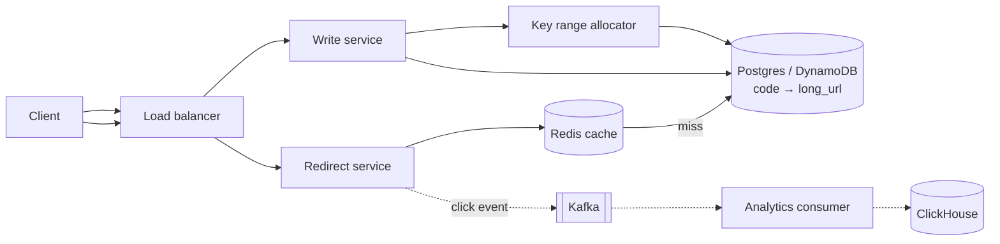
- **Codes**: each write server leases a block of counter values (e.g. 1,000 at a time) and base62-encodes them — no collisions, no per-request coordination. 7 chars = 3.5 trillion codes.
- **Reads dominate** (100:1): cache hot codes in Redis, read-through to DB; 302 if you need analytics, 301 if you want browsers to cache.
- **Clicks are async**: the redirect path never waits on analytics.
- Video: Hello Interview — Design Bitly: https://www.youtube.com/watch?v=iUU4O1sWtJA

### pastebin
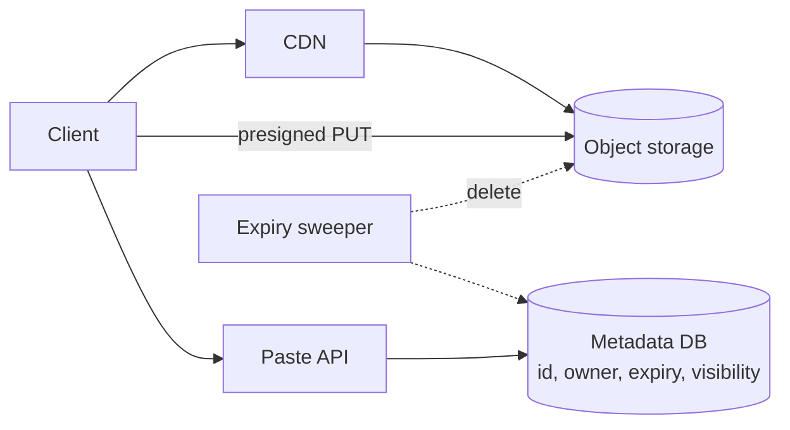
- Content lives in object storage, metadata in the DB; reads go through the CDN.
- Expiry: lifecycle rules or a sweeper over an `expires_at` index; delete content and metadata together.
- Rate-limit anonymous creates to stop abuse.

### rate-limiter
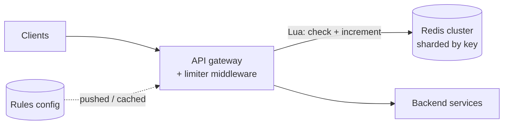
- **Algorithm**: sliding-window counter or token bucket in one atomic Lua script (no read-then-write races).
- **Placement**: in the gateway, keyed by API key / user / IP; rules cached locally and refreshed.
- **Redis down**: decide fail-open (availability) vs fail-closed (protection) per endpoint; optionally keep a coarse local limit as backstop.
- Return `429` + `Retry-After` + remaining-quota headers.
- Video: Hello Interview — Distributed Rate Limiter: https://www.youtube.com/watch?v=MIJFyUPG4Z4

### unique-id-generator
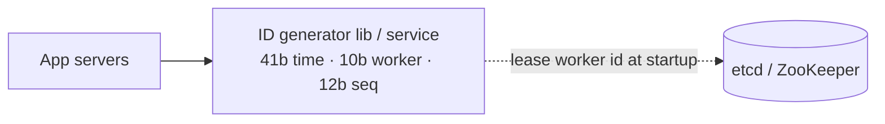
- Snowflake layout: ~69 years of ms timestamps, 1,024 workers, 4,096 IDs per ms per worker.
- Worker IDs are leased (with TTL) from etcd so two processes never share one.
- Clock goes backwards: refuse/wait until it catches up; never reuse a timestamp.

### key-value-cache
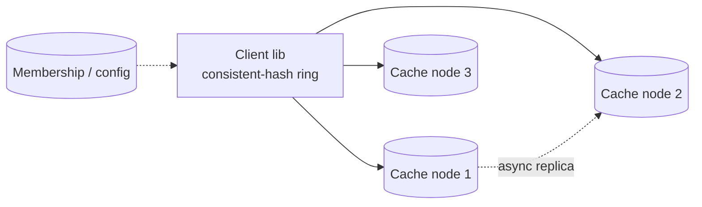
- Consistent hashing with ~100–200 virtual nodes per server; adding a node moves ~1/N of keys.
- LRU eviction + per-key TTL; memory per node sized from the working set.
- Hot keys: client-side near cache or key replication across several nodes.
- Stampede protection: request coalescing or early probabilistic refresh.

### news-feed
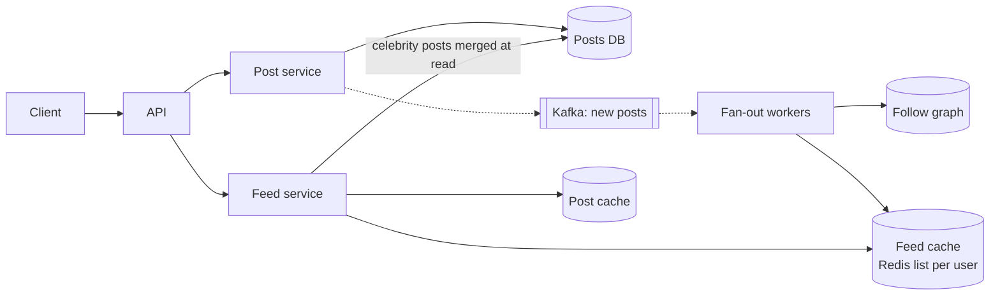
- **Hybrid fan-out**: push post IDs into followers' feed lists for normal users; for accounts above ~10K followers, pull their recent posts at read time and merge.
- Feed cache stores IDs only (~800 per user), hydrated from a post cache.
- Cursor pagination on (timestamp, post_id).
- Video: Hello Interview — Design FB News Feed: https://www.youtube.com/watch?v=Qj4-GruzyDU

### chat-app
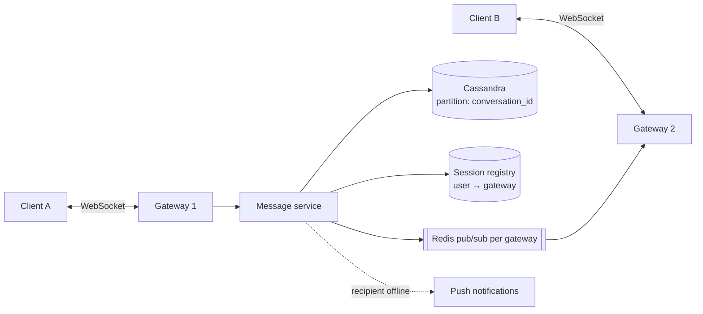
- Persist first, then deliver; client-generated message IDs make retries idempotent.
- Session registry (or pub/sub per user channel) routes a message to the gateway holding the recipient's socket.
- Order per conversation via a per-conversation sequence number; offline clients sync by "messages after seq N".
- Video: Hello Interview — Design WhatsApp: https://www.youtube.com/watch?v=cr6p0n0N-VA

### notification-system
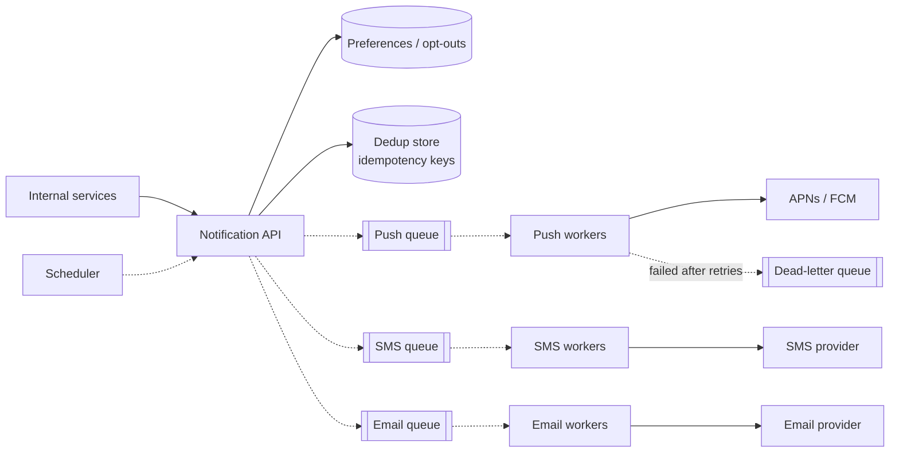
- Separate queue per channel so one slow provider doesn't block others.
- Idempotency key per notification → no duplicate texts on retries.
- Per-user rate limits and quiet hours applied before enqueueing.

### web-crawler
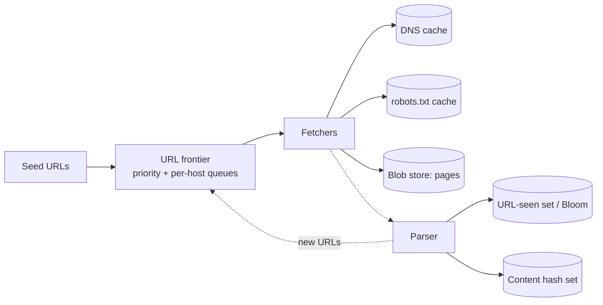
- Per-host queues enforce politeness (one connection per host, crawl-delay).
- URL-seen and content-hash dedup prevent loops and mirrors.
- Fetch work is leased; a dead fetcher's URLs return to the frontier after a timeout.
- Video: Hello Interview — Design a Web Crawler: https://www.youtube.com/watch?v=krsuaUp__pM

### file-sync
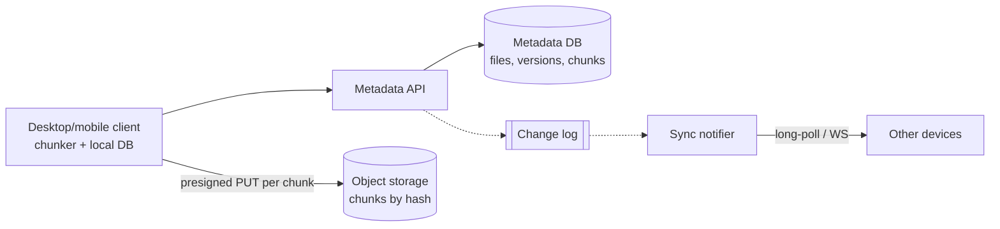
- Files split into ~4 MB chunks addressed by hash: dedup, resumable uploads, delta sync.
- Upload chunks directly to storage, then commit a new version in metadata (atomic).
- Conflicts: keep both versions ("conflicted copy") rather than silently overwrite.
- Video: Hello Interview — Design Dropbox: https://www.youtube.com/watch?v=_UZ1ngy-kOI

### video-streaming
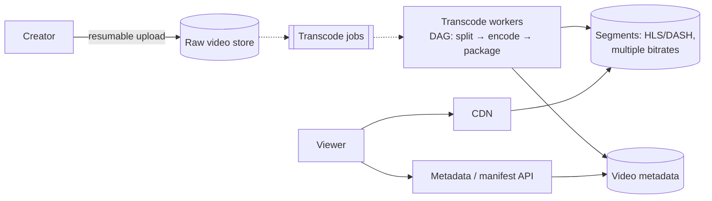
- Transcoding is async and parallel (split into segments, encode in parallel, reassemble).
- Adaptive bitrate: manifest lists renditions; the player switches by bandwidth.
- CDN serves nearly all bytes; origin only for the long tail.
- Video: Hello Interview — Design YouTube: https://www.youtube.com/watch?v=IUrQ5_g3XKs

### typeahead
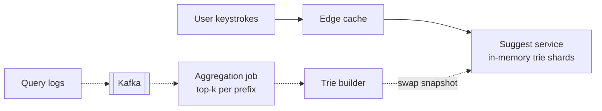
- Each trie node stores its precomputed top 10 completions → O(prefix length) lookups.
- Rebuilt from aggregated logs every few minutes and swapped atomically; trending terms come from a short-window stream job.
- Debounce on the client; cache short prefixes at the edge.

### proximity-search
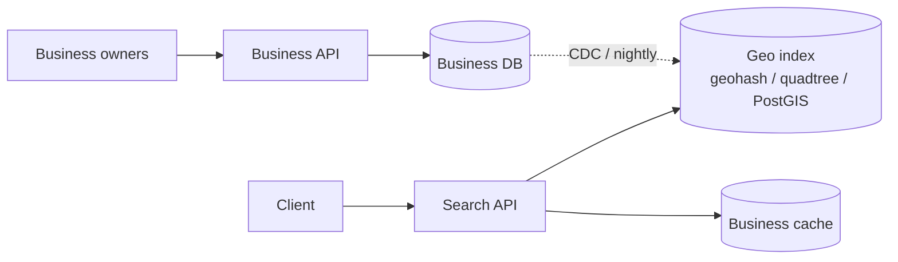
- Search neighbouring geohash cells (the 8 around the user's cell) to avoid edge misses; widen precision in sparse areas.
- Read path is read-replica + cache heavy; business updates propagate asynchronously.
- Video: Hello Interview — Design Uber (geo index walkthrough): https://www.youtube.com/watch?v=lsKU38RKQSo

### ticketmaster
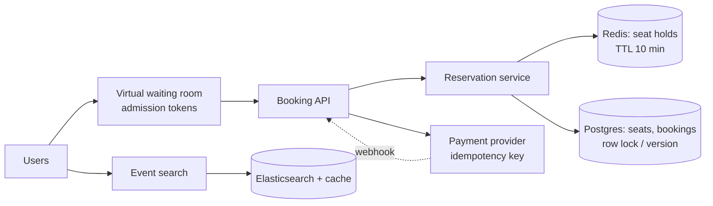
- Hold a seat with a TTL lock, confirm it in Postgres in one transaction after payment.
- A waiting room meters traffic at on-sale so booking servers see a steady flow.
- Search and event pages are cached and separate from the strongly consistent booking path.
- Video: Hello Interview — Design Ticketmaster: https://www.youtube.com/watch?v=fhdPyoO6aXI

### leaderboard
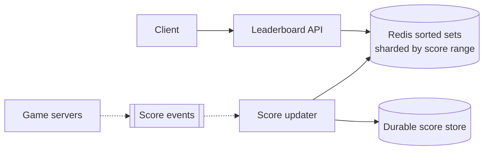
- `ZADD`/`ZREVRANK` give O(log n) updates and ranks; top-10 is `ZREVRANGE`.
- Beyond one node: shard by score range (rank = rank within shard + counts of higher shards).
- Durable store lets you rebuild Redis; monthly boards are separate keys.

### job-scheduler
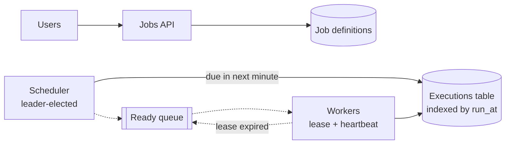
- Two tables: definitions (cron) and executions (one row per run, indexed by time).
- Workers lease a run and heartbeat; an expired lease returns it to the queue → at-least-once, so jobs must be idempotent.
- Spread "00:00" spikes with jitter and per-tenant limits.

### metrics-monitoring
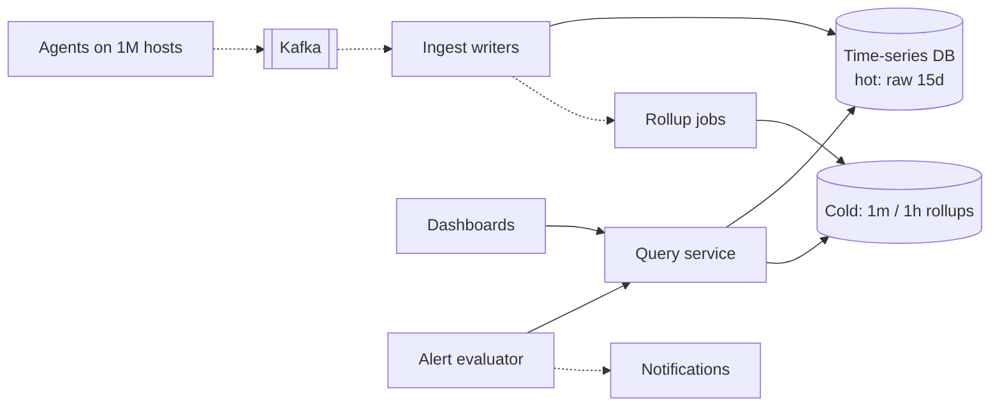
- Kafka absorbs bursts; TSDB with compression (delta-of-delta, Gorilla-style).
- Downsample for long retention; queries pick resolution by time range.
- Cap label cardinality per metric; alerts have dedup and hysteresis.

### ad-click-aggregator
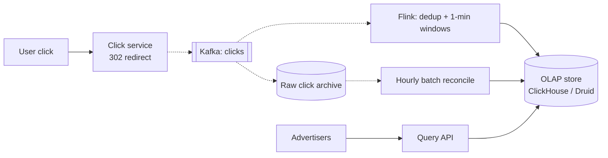
- Stream aggregation for freshness, batch reconciliation for billing accuracy.
- Dedup by click ID; watermarks handle late events.
- Hot ads: add a random suffix to the partition key, then merge.
- Video: Hello Interview — Design an Ad Click Aggregator: https://www.youtube.com/watch?v=Zcv_899yqhI

### ride-hailing
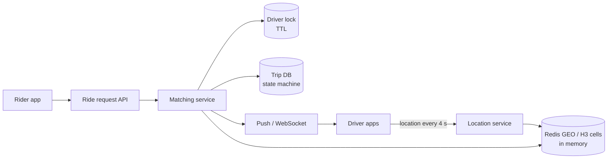
- Location pings stay in memory (~1M drivers × 1 write / 4 s = 250K writes/s); only trips are durable.
- Matching locks a driver with a TTL so one driver gets one offer at a time.
- Trip state machine (requested → accepted → in progress → done) in a durable DB.
- Video: Hello Interview — Design Uber: https://www.youtube.com/watch?v=lsKU38RKQSo

### instagram
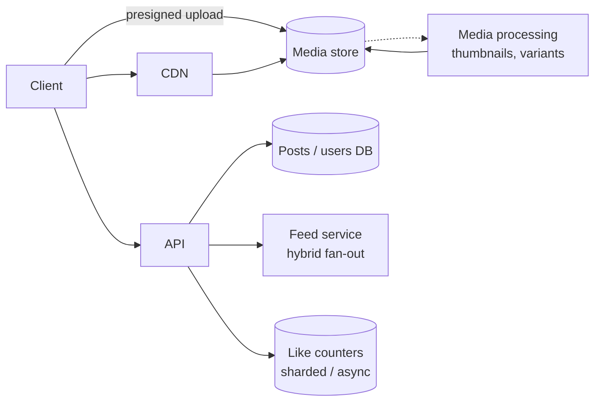
- Same feed approach as news-feed; media via CDN with multiple sizes.
- Likes: write to a likes table + increment sharded counters asynchronously; display approximate counts.

### payment-system
```mermaid
flowchart LR
  M[Merchant] --> PAPI[Payments API<br/>idempotency key] --> PDB[(Payment state machine)]
  PAPI -.-> OB[[Outbox → queue]] -.-> EX[PSP executor] --> PSP[Card network / PSP]
  PSP -.->|webhook| WH[Webhook handler] --> PDB
  PDB --> LED[(Double-entry ledger<br/>append-only)]
  REC[Daily reconciliation] --> LED
  REC --> PSP
```
- Idempotency key on every external call; payment states move forward only.
- Ledger is append-only double entry; balances are derived, never edited in place.
- PSP timeout = unknown: query status or wait for the webhook before retrying.

### google-docs
```mermaid
flowchart LR
  C1[Editor A] <-->|WebSocket| DS[Doc session server<br/>owns doc, sequences ops]
  C2[Editor B] <-->|WebSocket| DS
  DS --> OPS[(Operation log)]
  DS -.-> SNAP[Snapshotter] --> SDB[(Snapshots)]
  LB[Router: doc_id → session server] --> DS
```
- One session server per document serializes operations (OT) — or CRDTs if offline-first matters most.
- Op log + periodic snapshots; new clients load snapshot + ops since.
- Cursors and presence are ephemeral (not persisted).

### distributed-kv-store
```mermaid
flowchart LR
  C[Client] --> CO[Any node as coordinator]
  CO -->|N=3 replicas, W=2| A[(Node A<br/>LSM storage)]
  CO --> B[(Node B)]
  CO --> D[(Node C)]
  A <-.->|gossip membership| B
  A <-.->|Merkle anti-entropy| D
```
- Ring with virtual nodes; preference list of N replicas; tunable R/W quorum.
- Conflicts: vector clocks (return siblings) or last-write-wins with stated data-loss risk.
- Hinted handoff for temporary failures, Merkle trees for permanent repair.

### stock-exchange
```mermaid
flowchart LR
  BR[Brokers] --> GW[Order gateway<br/>risk checks] --> SEQ[Sequencer<br/>total order]
  SEQ --> ME[Matching engine<br/>1 thread per symbol, in memory]
  SEQ --> LOG[(Event log)]
  ME --> MD[Market data publisher] -.-> SUBS[Subscribers]
  LOG -.-> STBY[Hot standby replays log]
```
- Determinism: sequence everything, then replay to rebuild state on failover.
- Order book in memory, single-threaded per symbol; no DB on the hot path.

### llm-chat-service
```mermaid
flowchart LR
  U[Users] -->|SSE| GW[Gateway<br/>auth, quotas] --> CS[Chat service] --> CDB[(Conversations)]
  CS --> SCHED[Inference scheduler<br/>queue + priority by tier]
  SCHED --> GPU[GPU fleet<br/>continuous batching, KV cache]
  CS --> RAG[Retrieval] --> VDB[(Vector index)]
  CS -.-> USE[[Usage events]]
```
- Admission control and per-tier queues when GPUs saturate; shed or degrade (smaller model) instead of timing out everyone.
- Continuous batching + prefix/KV caching for throughput; stream tokens over SSE.
- Token-based quotas, not request counts.

### distributed-message-queue
```mermaid
flowchart LR
  P[Producers] --> L1[Broker: partition leader]
  L1 -->|replicate| F1[Follower broker]
  L1 --> SEG[(Segment files<br/>append-only)]
  CG[Consumer group] -->|fetch from offset| L1
  CTRL[Controller<br/>Raft metadata] -.-> L1
```
- Topics split into partitions; ordering only within a partition.
- acks=all + in-sync replica set for durability; controller handles leader election.
- Consumers own offsets; retention by time/size, not by consumption.
- Video: Hello Interview — Kafka deep dive: https://www.youtube.com/watch?v=DU8o-OTeoCc

### flash-sale
```mermaid
flowchart LR
  U[1M users] --> CDN[Static pages via CDN]
  U --> WR[Waiting room / admission] --> API[Purchase API]
  API --> INV[(Redis stock counter<br/>atomic Lua decrement)]
  API -.-> Q[[Order queue]] -.-> OW[Order workers] --> DB[(Orders DB)]
  RECON[Reconciler] --> INV
  RECON --> DB
```
- Atomic decrement-if-positive in Redis is the gate; orders are created asynchronously.
- Reservations expire if payment doesn't complete; the reconciler fixes drift between Redis and DB.

### rag-qa-service
```mermaid
flowchart LR
  SRC[Docs: wiki, PDFs, tickets] -.->|change events| ING[[Ingestion queue]] -.-> PROC[Parse → chunk → embed]
  PROC --> VI[(Vector index<br/>+ ACL metadata)]
  PROC --> KI[(Keyword index)]
  U[Employee] -->|SSE| API[Q&A API] --> RET[Hybrid retrieval<br/>ACL filter in query]
  RET --> VI
  RET --> KI
  RET --> RR[Reranker] --> LLM[LLM via gateway] --> API
  API -.-> FB[(Feedback + traces)]
```
- Permissions are a filter inside the retrieval query, so the LLM never sees text the user can't.
- Incremental ingestion from change events; deletes and ACL changes are fast-path.
- Keep embeddings versioned so a model change can backfill in the background.

### llm-gateway
```mermaid
flowchart LR
  T[Team services] --> GW[LLM gateway<br/>auth, routing, streaming passthrough]
  GW --> QT[(Token budgets<br/>Redis counters)]
  GW --> SC[(Semantic cache<br/>scoped per tenant)]
  GW --> P1[Provider A]
  GW --> P2[Provider B]
  GW --> HC[Health checker] -.-> GW
  GW -.-> U[[Usage events]] -.-> BILL[(Chargeback store)]
```
- Pre-check with estimated tokens, settle with actual usage after the response.
- Fail over only before the first token is sent, or tell the client the stream restarted.
- Usage logging is async; the gateway adds only a few ms.

### ai-code-review-bot
```mermaid
flowchart LR
  GH[GitHub webhooks] --> IN[Webhook intake<br/>verify + ack] -.-> Q[[Review jobs<br/>coalesced per PR]]
  Q -.-> W[Review workers<br/>per-repo concurrency]
  W --> IDX[(Repo index + conventions memory)]
  W --> LLM[LLM via gateway]
  W --> GHAPI[GitHub API<br/>idempotent comments]
  GHAPI -.->|resolved / dismissed| FB[(Feedback for evals)]
  REP[Repo indexer] -.-> IDX
```
- Ack the webhook in milliseconds; coalesce rapid pushes so only the latest commit is reviewed.
- Per-repo index updated incrementally on merge, not rebuilt per PR.
- Comment keys (file, line, rule) make reposting idempotent; dismissals feed quality evals.

### ai-agent-platform
```mermaid
flowchart LR
  U[User] --> API[Runs API] --> ORCH[Run orchestrator<br/>durable workflow, checkpoints]
  ORCH --> SB[Sandbox pool<br/>microVMs, warm, egress policy]
  ORCH --> LLM[LLM gateway<br/>per-run budget]
  SB --> TG[Tool gateway<br/>permissions + blast radius + audit]
  TG --> EXT[Git, web, package registries]
  ORCH -.-> EV[[Run events]] -.-> UI[Live run view]
  ORCH --> APR[Human approval for risky actions]
  ORCH --> ART[(Logs + artifacts)]
```
- The agent loop is a durable workflow: each step checkpointed, tools idempotent, so a worker crash resumes instead of restarting.
- Sandboxes have no ambient credentials; the tool gateway grants scoped, audited access per call.
- Budgets (tokens, wall-clock, tool calls) stop runaway loops.

### llm-eval-platform
```mermaid
flowchart LR
  SDK[SDK / OTel spans] -.-> K[[Kafka]] -.-> W[Writers] --> TS[(Columnar trace store<br/>retention tiers)]
  W --> BL[(Object store:<br/>large prompts/outputs)]
  UI[Trace explorer] --> QAPI[Query API] --> TS
  EVAL[Eval runner<br/>distributed batch] --> DS[(Versioned datasets + prompts)]
  EVAL --> SC[Scorers: code checks,<br/>LLM judges]
  EVAL --> RES[(Run results + diffs)]
```
- Spans in a columnar store with pointers to big payloads in object storage.
- Eval runs fan out across workers with provider rate limits; datasets, prompts and judges are versioned so runs are comparable.
- Calibrate LLM judges against a human-labelled sample before trusting them.
